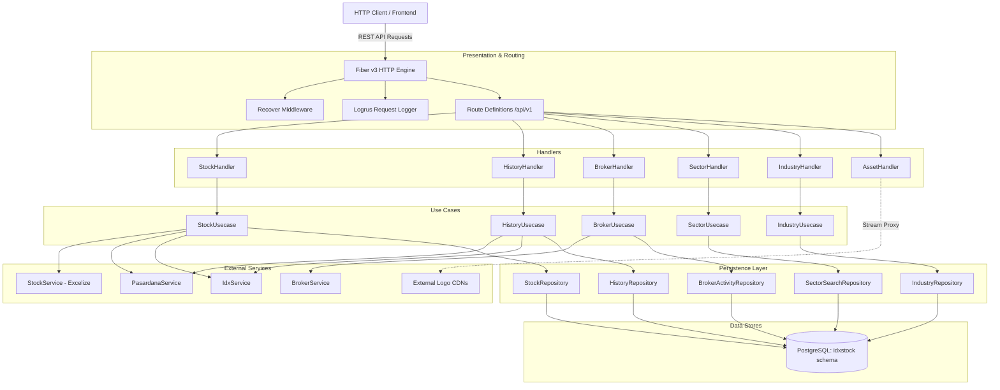

# Architecture & System Design

## 1. Architectural Pattern Evidence
- **Layered Architecture / Clean Separation (`CONFIRMED`)**:
  - Transport Layer: `internal/handlers` handling HTTP input/output via Fiber v3.
  - Domain / Business Logic Layer: `internal/usecases` encapsulating domain operations.
  - Integration Services: `internal/services` wrapping 3rd-party HTTP data providers and file readers.
  - Persistence Layer: `internal/repositories` encapsulating SQL queries and PostgreSQL connection pooling (`pgxpool.Pool`).
  - Cross-cutting Configuration: `internal/config`, `internal/database`, `internal/utils`.
- **Database Schema Partitioning (`CONFIRMED`)**:
  - Dynamic ISO-week table partitioning implemented for `broker_activity` table (`internal/repositories/broker_activity_repository.go#L44-L103`, `migrations/006_create_broker_activity_table.sql`).
- **Distributed Configuration Management (`CONFIRMED`)**:
  - Bootstrap integration with Spring Cloud Config server via `scc2go` during `init()` (`cmd/api/main.go#L20-L22`).

---

## 2. Component Architecture Diagram

---

## 3. Request & Data Lifecycle

### 3.1 Ingestion & Parsing (Excel Upload)
1. **Client Request**: `POST /api/v1/stocks/upload` or `PATCH /api/v1/stocks/upload` receives an `.xlsx` multipart file.
2. **File Processing**: `StockHandler` transfers reader to `StockUsecase`, which uses `StockService.ParseExcel` (`xuri/excelize/v2`).
3. **Data Normalization**: Values (Listing Date, Shares, Board Type) are normalized via `internal/utils`.
4. **Persistence**: `StockRepository.Upsert` executes batch operations against `idxstock.stocks`.

### 3.2 Market Synchronization (Pasardana & IDX)
1. **Trigger**: Synchronous `PUT` invocation (e.g., `/api/v1/stocks/history/sync` or `/api/v1/broker/sync`).
2. **External Retrieval**: Service layers (`IdxService`, `PasardanaService`, `BrokerService`) perform HTTP requests:
   - Sets custom User-Agents, Referers, Cookies (`internal/services/idx_service.go#L36-L55`) to navigate anti-scraping controls.
   - Decodes compressed or chunked JSON payloads.
3. **Database Write**: Upserted into PostgreSQL with partition checks or conflict updates (`ON CONFLICT DO UPDATE`).

### 3.3 Historical Price & Stock Split Engine
1. **Query**: `GET /api/v1/stocks/:code/history?start_date=...&end_date=...&fields=...` queries `idxstock.history`.
2. **Stock Split Adjustment**: `PUT /api/v1/stocks/split` accepts ratio changes (`from_ratio:to_ratio`) and adjusts historical prices (`close_price`, `open_price`, `high_price`, `low_price`) and multiplies `volume` prior to split date in an atomic SQL transaction (`internal/repositories/history_repository.go#L161-L200`).

---

## 4. Concurrency & Resource Management

- **Web Server Concurrency**: Fiber v3 built on Fasthttp event-driven worker pool model. Goroutines are spawned per incoming TCP connection.
- **Database Connection Pooling**:
  - Utilizes `github.com/jackc/pgx/v5/pgxpool`.
  - Configured from `db.idxstock.dsn` with thread-safe connection pooling across usecases and repositories.
- **Context Propagation**: Standard `context.Context` is passed across all service and repository calls for timeout and cancellation control.

---

## 5. Error Handling & Fault Tolerance

- **Panic Recovery**: `recover.New()` middleware mounted globally in Fiber (`cmd/api/main.go#L46`) protects against thread panics.
- **HTTP Status Codes**: Structured JSON error payloads (`fiber.Map{"error": err.Error()}`) returned across handlers.
- **Database Resilience**: Parameterized SQL queries avoid SQL injection; connection health verified at boot and via `/health` endpoint ping (`routes.go#L38-L49`).
- **Resilient Migration System**: Migration executor runs inside an isolated context transaction (`internal/database/database.go#L56-L134`) tracking applied scripts in `idxstock.schema_migrations`.

---

## 6. Observability & Telemetry

- **Structured Logging**: `github.com/sirupsen/logrus` with `JSONFormatter` logging to stdout (`internal/config/logger.go`).
- **HTTP Request Access Logs**: Custom Fiber middleware logs Method, Path, Status Code, Latency, and Client IP for every incoming request.
- **Health Check**: `/health` endpoint performs active DB connection ping against PostgreSQL pool.

---

## 7. Data & Domain Boundaries

- **Database Isolation**: Dedicated PostgreSQL schema `idxstock` houses all application tables:
  - `idxstock.stocks`
  - `idxstock.history`
  - `idxstock.brokers`
  - `idxstock.broker_activity` (partitioned weekly)
  - `idxstock.sectors`, `idxstock.sub_sectors`
  - `idxstock.industries`, `idxstock.sub_industries`
  - `idxstock.schema_migrations`
- **Models vs Entities**: Models defined in `internal/models/` serve dual purposes as DTOs and database mapping entities.
