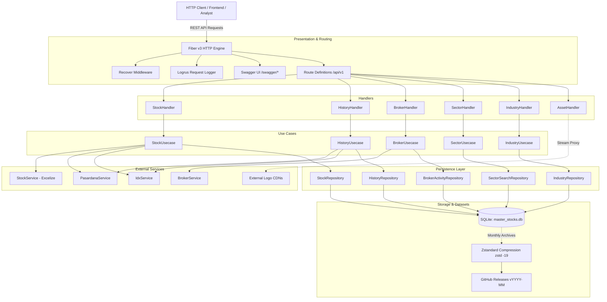

# Architecture & System Design

## 1. Architectural Pattern Evidence
- **Layered Architecture / Clean Separation (`CONFIRMED`)**:
  - Transport Layer: `internal/handlers` handling HTTP input/output via Fiber v3 with OpenAPI Swagger annotations.
  - Domain / Business Logic Layer: `internal/usecases` encapsulating domain operations.
  - Integration Services: `internal/services` wrapping 3rd-party HTTP data providers and file readers.
  - Persistence Layer: `internal/repositories` encapsulating SQL queries and transaction management via pure Go SQLite (`database.DBExecutor`).
  - Cross-cutting Configuration: `internal/config`, `internal/database`, `internal/utils`.
- **Pure-Go SQLite Persistence (`CONFIRMED`)**:
  - Embedded, CGO-free SQLite database engine (`modernc.org/sqlite`) utilizing file storage at `database/master_stocks.db` with automated embedded migrations (`migrations/*.sql`).
- **Distributed Configuration Management (`CONFIRMED`)**:
  - Bootstrap integration with Spring Cloud Config server via `scc2go` during `init()` (`cmd/api/main.go#L31-L33`).
- **Automated OpenAPI / Swagger Integration (`CONFIRMED`)**:
  - Synchronized OpenAPI 2.0 specs generated into `docs/` via `swag init` and served interactively at `/swagger/*` via `swaggo`.

---

## 2. Component Architecture Diagram

---

## 3. Request & Data Lifecycle

### 3.1 Master Equities Query & Ingestion
1. **Query All Stocks**: `GET /api/v1/stocks?board=...&search=...` queries `stocks` table via `StockRepository.GetAllStocks` with case-insensitive filtering on board and ticker/name, returning `[]models.StockDetailResponse`.
2. **Excel Ingestion**: `POST /api/v1/stocks/upload` or `PATCH /api/v1/stocks/upload` receives an `.xlsx` multipart file parsed by `StockService.ParseExcel` (`xuri/excelize/v2`), normalized via `internal/utils`, and batch-upserted into `stocks`.

### 3.2 Market Synchronization (Pasardana & IDX)
1. **Trigger**: Synchronous `PUT` invocation (e.g., `/api/v1/stocks/history/sync` or `/api/v1/broker/sync`).
2. **External Retrieval**: Service layers (`IdxService`, `PasardanaService`, `BrokerService`) perform HTTP requests:
   - Sets custom User-Agents, Referers, Cookies (`internal/services/idx_service.go#L36-L55`) to navigate anti-scraping controls.
   - Decodes compressed or chunked JSON payloads.
3. **Database Write**: Upserted into SQLite within atomic transactions (`ON CONFLICT (code) DO UPDATE`).

### 3.3 Historical Price & Stock Split Engine
1. **Query**: `GET /api/v1/stocks/:code/history?start_date=...&end_date=...&fields=...` queries `history` table.
2. **Stock Split Adjustment**: `PUT /api/v1/stocks/split` accepts ratio changes (`from_ratio:to_ratio`) and adjusts historical prices (`close`, `open_price`, `high`, `low`) and multiplies `volume` prior to split date in an atomic SQLite SQL transaction (`internal/repositories/history_repository.go#L161-L200`).

---

## 4. Concurrency & Resource Management

- **Web Server Concurrency**: Fiber v3 built on Fasthttp event-driven worker pool model. Goroutines are spawned per incoming TCP connection.
- **Database Connection Management**:
  - Utilizes pure Go SQLite via `modernc.org/sqlite` wrapped by `database.DBExecutor`.
  - Configured from `DATABASE_URL` environment variable (default: `database/master_stocks.db`).
  - Thread-safe query and execution model supporting atomic transactions.
- **Context Propagation**: Standard `context.Context` is passed across all service and repository calls for timeout and cancellation control.

---

## 5. Error Handling & Fault Tolerance

- **Panic Recovery**: `recover.New()` middleware mounted globally in Fiber (`cmd/api/main.go#L42`) protects against thread panics.
- **HTTP Status Codes**: Structured JSON error payloads (`fiber.Map{"error": err.Error()}`) returned across handlers.
- **Database Resilience**: Parameterized SQLite queries avoid SQL injection; connection health verified at boot and via `/health` endpoint ping (`internal/routes/routes.go#L48-L65`).
- **Resilient Migration System**: Migration executor runs inside an isolated transaction (`internal/database/database.go#L56-L134`) tracking applied scripts in `schema_migrations`.

---

## 6. Observability & Telemetry

- **Structured Logging**: `github.com/sirupsen/logrus` with `JSONFormatter` logging to stdout (`internal/config/logger.go`).
- **HTTP Request Access Logs**: Custom Fiber middleware logs Method, Path, Status Code, Latency, and Client IP for every incoming request.
- **Interactive Documentation**: Swagger UI at `/swagger/*` with generated OpenAPI 2.0 schemas.
- **Health Check**: `/health` endpoint performs active DB connection ping against the SQLite connection pool.

---

## 7. Data & Domain Boundaries

- **Database Tables**: Dedicated SQLite tables house application data:
  - `stocks`
  - `listing_board`
  - `history`
  - `brokers`
  - `broker_activity`
  - `sector`, `sub_sector`
  - `industry`, `sub_industry`
  - `schema_migrations`
- **Models vs Entities**: Models defined in `internal/models/` serve dual purposes as DTOs, API schema annotations, and database mapping entities.
